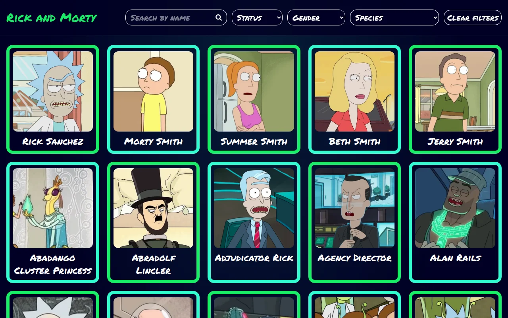
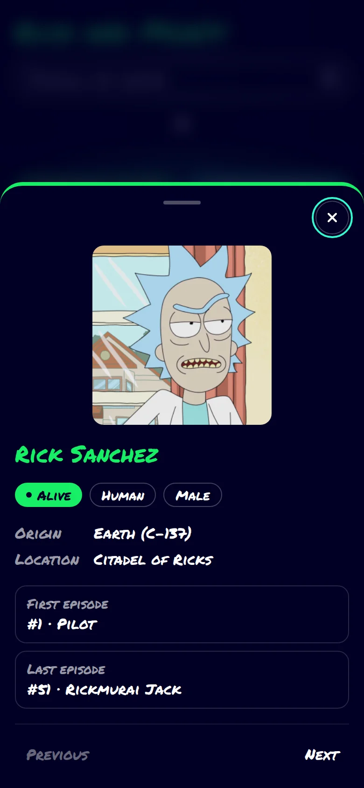

# Rick and Morty Explorer

[](https://github.com/CarlosLagos29/ChallengeRickAndMorty_dev/actions/workflows/ci.yml)

Search and filter every character of the show using the public [Rick and Morty GraphQL API](https://rickandmortyapi.com/documentation/#graphql).

**Live demo:** https://challengerickandmorty.netlify.app/

<p align="center">
  
  &nbsp;
  
</p>

## Features

- **Search** characters by name.
- **Filters** by status, gender and species that can be combined with each other and with the search.
- **Pagination** with first/last page shortcuts. It shows 10 pages on desktop and 3 on mobile.
- **Character details** in a modal: a centered dialog on desktop and a bottom sheet on mobile that you can drag down to close.
- **Shareable URLs:** filters, page and the open character live in the query string (`/?status=Alive&page=2&character=1`). Refreshing keeps everything, and the browser back button closes the modal.
- **Responsive** from 360px, accessible with the keyboard and with `prefers-reduced-motion` support.

## Tech stack

| Area    | Tools                                         |
| ------- | --------------------------------------------- |
| UI      | React 19, TypeScript (strict), Tailwind CSS 4 |
| Data    | Apollo Client 4, GraphQL                      |
| Routing | React Router 8                                |
| Build   | Vite 8                                        |
| Quality | ESLint, Prettier, Vitest, Testing Library     |
| CI/CD   | GitHub Actions, Netlify                       |

## Technical decisions

**The URL is the state.** There is no global store. Filters, the current page and the open character are query params, read and written through two small hooks (`useCharacterFilters` and `useCharacterModal`). Server data lives in the Apollo cache, so going back to a page you already visited doesn't trigger a new request. An earlier version used Redux Toolkit; removing it made the app simpler and gave it shareable links for free.

**A single route.** The character details are a modal opened with `?character=<id>` instead of a `/detail/:id` page. The app only needs the `/` route, so deep links can't break because of how the host handles client-side routing.

**Working around the API rate limit.** The API has no endpoint that lists species, and it allows about 30 requests per IP. The first version fetched all 42 pages of characters to build the species filter, which hit the limit on every load. Now the app asks for the total number of characters and fetches all of them in one `charactersByIds` request that only asks for the `species` field: 2 requests in total, and the list still updates by itself if the API adds new species.

**Native `<dialog>`.** The modal uses `showModal()`, which gives focus trapping, closing with Esc and the top layer without extra libraries.

**No third-party images.** The loader and the 404 page use an animated SVG portal drawn in code, and the font is self-hosted. The only remote images are the character pictures from the API.

## Getting started

Requires **Node.js 24** (see `.nvmrc`).

```bash
nvm use
npm install
npm run dev
```

The app runs at http://localhost:5173.

### Scripts

| Script                | Description                                                                              |
| --------------------- | ---------------------------------------------------------------------------------------- |
| `npm run dev`         | Start the development server                                                             |
| `npm run build`       | Build for production                                                                     |
| `npm run preview`     | Preview the production build                                                             |
| `npm run lint`        | Type check, lint and check formatting                                                    |
| `npm run lint:fix`    | Fix lint errors and format the code                                                      |
| `npm test`            | Run the test suite                                                                       |
| `npm run test:watch`  | Run the tests in watch mode                                                              |
| `npm run screenshots` | Regenerate the README screenshots (needs Chrome; set `CHROME_PATH` if it isn't detected) |

## Project structure

```
src/
├── components/   Presentational components (cards, filters, modal, pagination, portal)
├── constants/    Filter options
├── graphql/      Typed GraphQL queries
├── hooks/        URL state, species and media query hooks
├── lib/          Apollo Client setup
├── pages/        Components that fetch data (home, character details, 404)
├── styles/       Theme tokens for Tailwind
├── test/         Test setup and helpers
├── types/        Domain types
└── utils/        Pure helpers (pagination window)
```

## Testing

Tests live next to the code they cover (`*.test.ts(x)`) and run with Vitest and Testing Library in jsdom. They never call the real API: every request is mocked with Apollo's `MockedProvider`, so they are fast and deterministic.

They cover the pagination logic, the URL state hooks, the components (search, filters and pagination) and the main flows: loading, filtering, empty and error states, and opening, navigating and closing the character modal.

## CI/CD

- **GitHub Actions** runs type checking, lint, formatting, tests and the build on every pull request and every push to `main`.
- **Netlify** runs the same checks before deploying, so a failing check never reaches production.

## Credits

Data and character images come from [The Rick and Morty API](https://rickandmortyapi.com/). Rick and Morty is created by Justin Roiland and Dan Harmon and is a trademark of Adult Swim. This is a non-commercial fan project.
